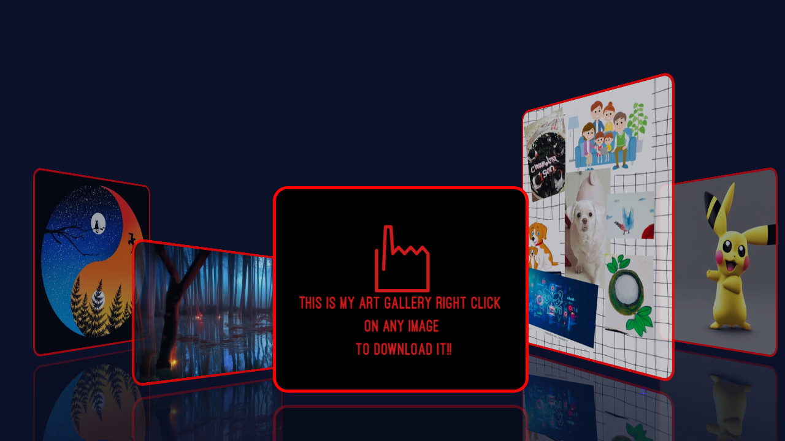

# Art-Gallery-

**Live demo:** https://chandrasen74.github.io/Art-Gallery-/  
**Repository:** https://github.com/Chandrasen74/Art-Gallery-



## Overview
`Art-Gallery-` is a HTML/CSS/JavaScript project.
- **Primary language:** HTML
- **Languages detected:** CSS, HTML, JavaScript
- **Stack/tech:** HTML, CSS, JavaScript
- **Entry point:** `index.html`
- **Key files:** `index.html`

## Language & stack details
- Languages: CSS, HTML, JavaScript
- Frameworks/tools/libraries: HTML, CSS, JavaScript

## How to install & run
### Prerequisites
- A modern web browser
- (Optional) [Python 3](https://www.python.org/) or any static file server for local serving

### Run locally
```bash
git clone https://github.com/Chandrasen74/Art-Gallery-.git
cd Art-Gallery-
```
- **Option 1:** open `index.html` directly in your browser
- **Option 2:** serve locally (recommended for some JS features):
```bash
python -m http.server 8000
# then open http://localhost:8000
```

## Repository structure (top-level/sample)
- `README.md`
- `images/2KDbcPpsfUX0StD3BxAy--1--xm2v7.jpg`
- `images/Cartoon Banyea.jpg`
- `images/Caves And Cliffs.jpg`
- `images/Day and night.jpg`
- `images/Glowing Wetlands.jpg`
- `images/IMG_9861 (2).jpg`
- `images/LOL.jpg`
- `images/Lh7R231z5DlJmc8rABPU--1--M9C81.jpg`
- `images/Mamami Assignment.jpg`
- `images/Minebrine.jpg`
- `images/Mountains.jpg`
- `images/R8Keyj5KTs59PMBAcKah--1--tcp3q.jpg`
- `images/SRDYyuQtRVguTdfZVZ4y--1--H9H2P.jpg`
- `images/TkssC3pR390MGHs2iFGv--1--3XBRA.jpg`
- `images/aD2SsV7aIpukp3ueLdmS--1--clt10.jpg`
- `images/download.png`
- `images/mKGAG21nR3d2NzStJNeR--1--0KWZB.jpg`
- `images/vqXhRrJ4rhkQSKwQtHYb--1--HWA9R.jpg`
- `index.html`
- `jquery.flipster.min.css`
- `jquery.flipster.min.js`
- `screenshot.png`
- `style.css`

## Status
Documented with screenshot, language/stack details, and setup instructions as part of a profile-wide README update.
